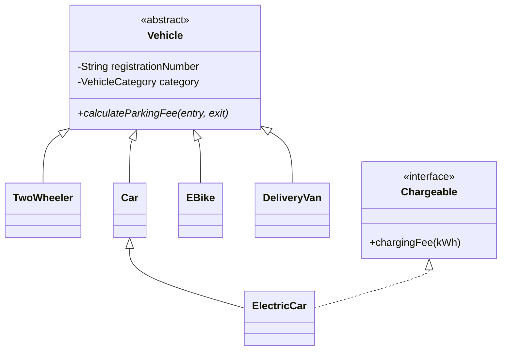

# Task 6 – Inheritance Hierarchy and UML

## Hierarchy
`Vehicle` is an abstract superclass. `TwoWheeler`, `Car`, `EBike` and `DeliveryVan` extend it. `ElectricCar` extends `Car`, and implements `Chargeable`.

## UML (text form)

## Constructor trace
Creating `new ElectricCar("TN01AB1234")` calls the `ElectricCar` constructor, then the protected `Car` constructor, then the `Vehicle` constructor. The category is explicitly set to `ELECTRIC_CAR`.

## Evidence
Capture the class declarations and be ready to explain `extends` versus `implements`.
